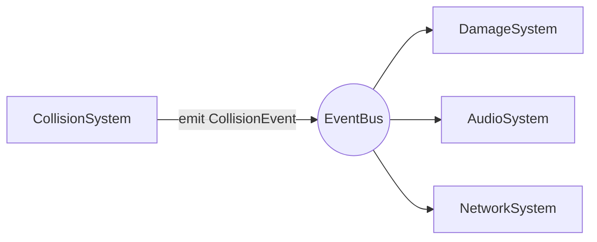

# Event

This folder contains the event layer of the ECS: how systems communicate
**without knowing each other**.

| File               | Content                                                        |
|--------------------|----------------------------------------------------------------|
| `Event.hpp`        | The `Event` concept: any copyable struct                       |
| `EventChannel.hpp` | `EventChannel<E>`: the handlers subscribed to one event type   |
| `Subscription.hpp` | `Subscription`: keeps a handler subscribed while alive (RAII)  |
| `EventBus.hpp`     | `EventBus`: queues events and delivers them to the subscribers |

---

## Why an event bus?

Systems must never call each other. This is forbidden:

```cpp
// Inside CollisionSystem
damageSystem.applyDamage(a, b);   // Collision now depends on Damage
audioSystem.playExplosion();      // ... and on Audio, and on Network...
```

Instead, the system that detects something **announces** it, and every system
interested in it **listens**:



`CollisionSystem` does not know who listens. Adding a new listener (a
particle effect, a statistics counter...) never requires changing it.

---

## Events

An event is a plain struct describing **something that happened**:

```cpp
struct CollisionEvent {
    ecs::Entity first;
    ecs::Entity second;
};

struct DeathEvent {
    ecs::Entity entity;
};
```

Any copyable type works (the `Event` concept). There is no base class and no
registration. Name events in the past tense or with an `Event` suffix, and
keep them small: they are copied into the queue.

---

## API

### `EventBus`

| Method                     | Behavior                                                         |
|----------------------------|------------------------------------------------------------------|
| `subscribe<E>(handler)`    | Subscribes `handler(const E&)`. Returns a `Subscription` that keeps it subscribed |
| `emit(event)`              | **Queues** the event. Nothing is delivered yet. Dropped if nobody listens to `E` |
| `dispatch()`               | Delivers every queued event, in emission order                   |
| `pendingCount()`           | Number of queued events                                          |
| `subscriberCount<E>()`     | Number of handlers subscribed to `E`                             |
| `clear()`                  | Drops the queued events. Subscriptions are kept                  |

The `World` owns an `EventBus` (`world.events()`) and calls `dispatch()` at
the end of `world.update(time)`, after every system has run.

### `Subscription`

| Method       | Behavior                                                       |
|--------------|----------------------------------------------------------------|
| destructor   | Unsubscribes the handler                                       |
| `reset()`    | Unsubscribes now (harmless if already done)                    |
| `active()`   | `true` while subscribed to a living bus                        |
| move         | Transfers the registration. Copy is forbidden                  |

**Always store the returned `Subscription`.** `subscribe` is `[[nodiscard]]`:
ignoring its result would unsubscribe the handler immediately.

---

## How it works

### Queued delivery

`emit()` does not call the handlers. It stores the event and returns.
`dispatch()` delivers everything later, at a fixed point of the frame:

```text
world.update(time)
 ├── InputSystem::update      emit(...)   -> queued
 ├── MovementSystem::update
 ├── CollisionSystem::update  emit(CollisionEvent)  -> queued
 └── events().dispatch()      -> DamageSystem, AudioSystem... are called now
```

Why queue instead of calling the handlers immediately?

- **No surprise in the middle of a query.** A handler that destroys an entity
  while `CollisionSystem` is iterating its storages would break the iteration.
  With the queue, handlers run after every system has finished.
- **Predictable order.** Events are delivered in the order they were emitted,
  across all types.

### Chained events

A handler can emit new events. They are delivered **in the same
`dispatch()`**, after the events already queued:

```text
queue: [Collision(#0,#1)]
dispatch, round 1: Collision -> DamageSystem emits Death(#1)
dispatch, round 2: Death(#1) -> AudioSystem plays the explosion
queue: []
```

To protect against endless loops (A emits B, B emits A...), one `dispatch()`
runs at most `EventBus::MaxDispatchRounds` (16) rounds. Whatever is left waits
for the next `dispatch()`.

### Inside: one channel per type

```text
EventBus
├── channels: type -> EventChannel<E>       (the handlers of each type)
│     ├── CollisionEvent -> [DamageSystem handler, AudioSystem handler]
│     └── DeathEvent     -> [AudioSystem handler]
└── queue: [deliver(Collision{...}), deliver(Death{...}), ...]   (in emission order)
```

Each queued element remembers its event and its channel, so `dispatch()`
simply runs them in order.

### Safety rules (all tested)

| Situation                                         | Behavior                                         |
|---------------------------------------------------|--------------------------------------------------|
| A handler unsubscribes itself during delivery     | It is not called again                           |
| A handler unsubscribes another one during delivery| The other one is skipped if it has not run yet   |
| A handler subscribes a new handler during delivery| The new handler only receives the next events    |
| An event is emitted, then the handler unsubscribes before `dispatch()` | Not delivered to it  |
| `dispatch()` is called from inside a handler      | Ignored: the outer `dispatch()` delivers everything |
| A `Subscription` outlives the `EventBus`          | Safe: it notices the bus is gone (`weak_ptr`)    |
| A handler throws                                  | The exception propagates; the bus stays usable   |

---

## Using events in a system

Subscribe in the constructor and keep the `Subscription` as a member: the
handler is automatically removed when the system is destroyed.

```cpp
class DamageSystem final : public ecs::System {
public:
    explicit DamageSystem(ecs::World& world)
        : _world(world)
        , _onCollision(world.events().subscribe<CollisionEvent>(
              [this](const CollisionEvent& event) { onCollision(event); }))
    {
    }

    void update(ecs::World&, const ecs::Time&) override { }

private:
    void onCollision(const CollisionEvent& event)
    {
        // ... apply damage, maybe emit DeathEvent ...
    }

    ecs::World& _world;
    ecs::Subscription _onCollision;
};

world.systems().add<DamageSystem>(world);
```

Emitting is a one-liner, from any system:

```cpp
world.events().emit(CollisionEvent{.first = a, .second = b});
```

---

## Example

Output of a real program: a collision system emits a collision every frame,
a damage system listens to collisions and emits deaths, an audio system
listens to deaths. None of them knows the others.

```text
Frame 1
  [Collision] emit CollisionEvent(#0, #1)
  [Damage]    #0 -> 60 HP
  [Damage]    #1 -> 30 HP
Frame 2
  [Collision] emit CollisionEvent(#0, #1)
  [Damage]    #0 -> 20 HP
  [Damage]    #1 -> -10 HP
  [Damage]    emit DeathEvent(#1)
  [Audio]     play explosion for #1      <- chained event, same frame
```

Tests: [`tests/ecs/Event/`](../../../tests/ecs/Event) and
[`tests/ecs/World/WorldEventsTests.cpp`](../../../tests/ecs/World/WorldEventsTests.cpp).
